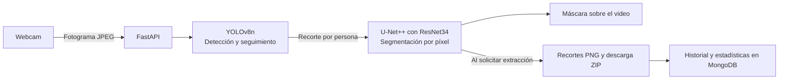

# Segmentación semántica de ropa

**Visión por computador aplicada a video de webcam**

Proyecto académico de la Escuela Politécnica Nacional · Equipo de cuatro integrantes

La aplicación detecta personas en el fotograma, segmenta sus prendas y muestra la máscara sobre el video. Desde la misma interfaz se pueden extraer prendas en PNG con transparencia, consultar el historial y descargar los archivos en ZIP.

[Arquitectura](#arquitectura) · [Demo local](#ejecutar-en-windows) · [Experimentos](notebooks/README.md) · [Equipo](#equipo)

## Arquitectura



| Componente | Función |
| --- | --- |
| **YOLOv8n** | Detecta personas y les asigna un ID de seguimiento. Se amplía cada recorte para conservar contexto. |
| **U-Net++** | Usa ResNet34 y atención SCSE para clasificar cada píxel del recorte en fondo, prenda superior, prenda inferior, calzado o cuerpo. |
| **FastAPI y OpenCV** | Reciben el fotograma, preparan la imagen, generan máscaras y recortes y exponen la API con autenticación JWT. |
| **Frontend y MongoDB** | La interfaz controla la cámara y presenta los resultados. MongoDB guarda los metadatos de las extracciones. |

La inferencia usa recortes RGB de **384 × 384**, normalización ImageNet y un promedio de las predicciones del recorte original y su reflejo horizontal. La máscara se ajusta al tamaño del recorte con interpolación por vecino más cercano para conservar las etiquetas.

## Experimentos

El trabajo comenzó con la exploración de imágenes y máscaras y una prueba con **DeepLabV3+**. La entrega final usa **U-Net++** para segmentar cada recorte. Los [notebooks](notebooks/README.md) documentan la preparación de datos, los aumentos de entrenamiento y las pruebas de inferencia.

## Ejecutar en Windows

Necesitas Git, Python 3.11, MongoDB accesible y los dos checkpoints indicados abajo. El frontend usa HTML, CSS y JavaScript y se sirve con Python.

Desde la raíz del repositorio, en PowerShell:

```powershell
cd Backend
py -3.11 -m venv .venv
.\.venv\Scripts\python.exe -m pip install -r requirements.txt
Copy-Item .env.example .env
.\.venv\Scripts\python.exe -c "import secrets; print(secrets.token_hex(32))"
```

Pega la clave generada en `JWT_SECRET_KEY` dentro de `Backend/.env`. El valor de `MONGO_URL` presupone una instancia local en el puerto 27017. Si usas otra instancia, configura su URI ahí.

Crea `Backend/models/` si hace falta y copia estos archivos desde `ProyectoPresentado/Backend/models/` o desde una distribución autorizada por el equipo:

| Archivo | Función |
| --- | --- |
| `mejor_modelo_384_fixed_body.pth` | Segmentación de cinco clases |
| `yolov8n.pt` | Detección y seguimiento de personas |

Desde `Backend/`, con MongoDB en marcha:

```powershell
.\.venv\Scripts\python.exe create_users.py
.\.venv\Scripts\python.exe main.py
```

En otra terminal, desde la raíz:

```powershell
py -3.11 -m http.server 8080 --bind 127.0.0.1 --directory Frontend
```

Abre [la interfaz](http://localhost:8080), inicia sesión con el administrador que acabas de crear y permite el acceso a la cámara. La [documentación OpenAPI](http://localhost:8000/docs) describe los endpoints. El backend está configurado para una demo local. Si cambias de puerto, actualiza también la URL base del frontend o los orígenes CORS, según corresponda.

El seguimiento se mantiene durante la sesión de la aplicación. El historial agrupa por ID de seguimiento y una nueva extracción del mismo ID puede actualizar el registro y los archivos asociados.

## Estructura

| Ruta | Contenido |
| --- | --- |
| `Backend/` | API, autenticación, inferencia, extracción e historial |
| `Frontend/` | Cámara, resultados, historial y administración |
| [`notebooks/`](notebooks/README.md) | Exploración de máscaras, experimento DeepLabV3+ y entrenamiento U-Net++ |

## Equipo

Proyecto desarrollado en conjunto por cuatro estudiantes de la Escuela Politécnica Nacional.

- [Pablo Pacheco](https://github.com/lpachecol)
- [César Zapata](https://github.com/Cesarbmm)
- [Christian Ayala](https://github.com/Handresth404)
- [Jhonn Saeteros](https://github.com/JASL22)
